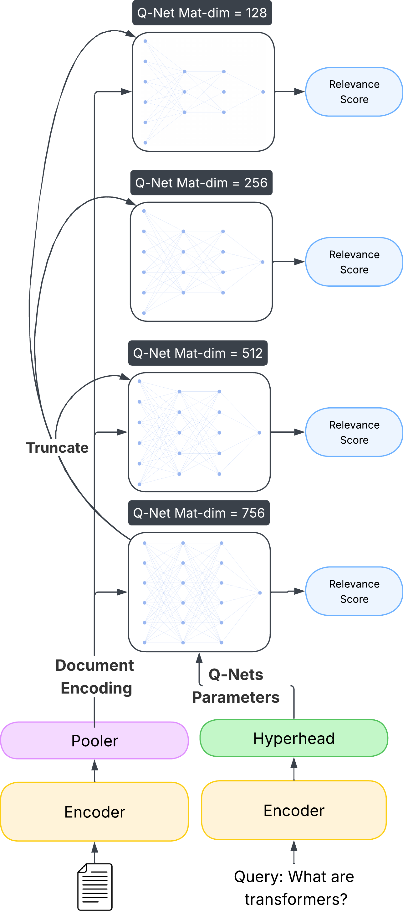
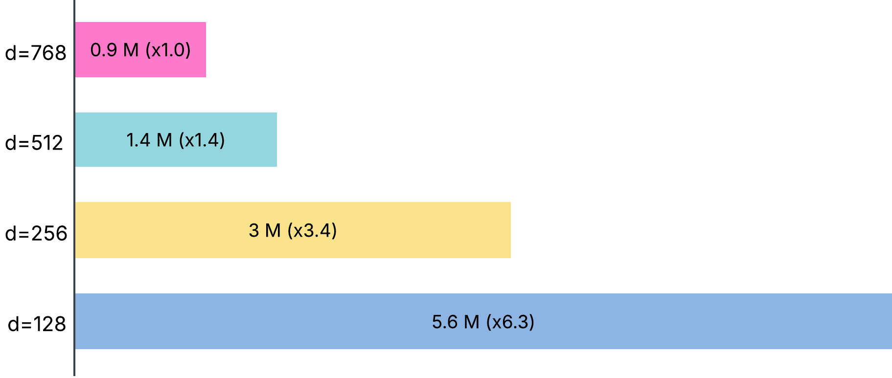

# Matryoshka Hypencoder

[](https://huggingface.co/majdalkawaas/matryoshka-hypencoder)
[](https://arxiv.org/abs/2607.17457)
[](https://www.python.org/)
[](./LICENSE)

This is the official Repository for "The Matryoshka Hypencoder".

This repository contains the code and experiments for the [The Matryoshka Hypencoder](https://arxiv.org/pdf/2607.17457) you can also find our proposed [Matryoshka Hypencoder model on huggingface](https://huggingface.co/majdalkawaas/matryoshka-hypencoder) This work builds upon the original [Hypencoder architecture](https://arxiv.org/abs/2502.05364) by Killingback et al., extending it with a novel, flexible training paradigm inspired by Matryoshka Representation Learning (MRL).

The primary contribution of this project is a single, adaptive retrieval model capable of generating query-specific scoring functions (Q-Nets) of variable widths. This allows for a dynamic trade-off between retrieval effectiveness and computational efficiency at inference time.


<p align="center">
  
  <br>
  <em>Figure 1: Overview of the Matryoshka Hypencoder architecture. The hyper-head generates a single set of full-size parameters, which can be truncated to form effective, nested Q-Nets of varying widths.</em>
</p>


<h4 align="center">
    <p>
        <a href="#key-contributions-and-findings">Key Findings</a> |
        <a href="#installation">Installation</a> |
        <a href="#training-a-new-model">Training</a> |
        <a href="#evaluation-framework">Evaluation</a>
    <p>
</h4>

## Key Contributions & Findings

This research makes several key contributions to the field of neural information retrieval:

1.  **Viability of Frozen-Encoder Training**: We demonstrate that a Hypencoder can be trained with its BERT backbones frozen, achieving performance statistically comparable to the original, resource-intensive end-to-end trained model. This establishes a computationally feasible paradigm for developing and experimenting with Hypencoder architectures.

2.  **Development of the Matryoshka Hypencoder**: We successfully adapt the MRL principle from embedding vectors to the parameter space of a function generator. Through a robust transfer learning methodology, we fine-tuned a pre-trained hyper-head with a multi-objective loss to produce nested, variable-width Q-Nets.

3.  **Demonstrated Performance-Efficiency Trade-off**: Our final Matryoshka model exhibits the desired "graceful degradation" property. On in-domain benchmarks like TREC Deep Learning, the model can be truncated to use **7x fewer active parameters** (256-dim vs. 768-dim Q-Net) with no statistically significant loss in retrieval effectiveness.

4.  **Quantified Efficiency Gains**: This parameter reduction translates to a massive gain in scoring throughput. As shown below, smaller Q-Nets are progressively faster, with the 128-dimension Q-Net providing up to a **5.6x speedup** in query latency on large corpora compared to the baseline.


<p align="center">
  
  <br>
  <em>Figure 2: Document scoring throughput (documents per second) on MS MARCO Dev, demonstrating the super-linear efficiency gains of smaller Q-Net dimensions.</em>
</p>

### Results:


**In-domain performance comparison:** 

| **Model** | **# Q-Net Params** | **DL'19 (nDCG@10)** | **DL'20 (nDCG@10)** | **Dev (MRR@10)** |
| :--- | :--- | :--- | :--- | :--- |
| **MH d=768** | 4,134,912 | .734 | .723 | .380† |
| **MH d=512** | 1,970,176 | .738 | .729 | .381† |
| **MH d=256** | 591,616 | .741 | .728 | .379† |
| **MH d=128** | 197,632 | .734 | .725 | .375†* |
| **Hyp-Fr (Ours)** | ≈4.1M | .728 | .729 | .373† |
| **Original Hypencoder** | ≈4.1M | .742 | .730 | .386 |
| **BM25** | - | .498 | .479 | .188 |

*(MH d refers to our Matryoshka Hypencoder at a Q-Net hidden dimension of d. Hyp-Fr is our frozen-encoder model. † indicates a statistically significant difference (p < 0.05) compared to the Original Hypencoder baseline, and * shows significance compared to MH d=768.)*

---

**Zero-shot performance (nDCG@10) on out-of-domain BEIR datasets:**


| **Model** | **TC** | **FQA** | **DB** | **NF** | **WT** |
| :--- | :--- | :--- | :--- | :--- | :--- |
| **MH d=768** | .685 | .312 | .414 | .324 | .272 |
| **MH d=512** | .684 | .311 | .414 | .324 | .271 |
| **MH d=256** | .678† | .306†* | .414 | .324 | .266 |
| **MH d=128** | .670† | .304†* | .412 | .323 | .259* |
| **Hyp-Fr (Ours)** | .699 | .314 | .419 | .311† | .250 |
| **Original Hypencoder** | .698 | .314 | .419 | .324 | .258 |
| **BM25** | .610 | .253 | .303 | .318 | .332 |

*(TC is TREC-COVID, FQA is FiQA, NF is NFCorpus, DB is DBPedia, and WT is Webis-Touché. † indicates a statistically significant difference (p < 0.05) compared to the Original Hypencoder baseline, and * shows significance compared to MH d=768.)*

---

**Average document scoring throughput:** 

| **Q-Net** | **Dev** | **TC** | **FQA** | **DB** | **NF** | **WT** |
| :--- | :--- | :--- | :--- | :--- | :--- | :--- |
| **d=768** | 0.9M (1.0x) | 0.9M (1.0x) | 0.7M (1.0x) | 0.9M (1.0x) | 0.2M (1.0x) | 0.9M (1.0x) |
| **d=512** | 1.4M (1.6x) | 1.3M (1.5x) | 0.9M (1.3x) | 1.4M (1.6x) | 0.2M (1.0x) | 1.4M (1.6x) |
| **d=256** | 3.0M (3.4x) | 2.4M (2.8x) | 1.4M (2.0x) | 3.0M (3.4x) | 0.2M (1.1x) | 2.7M (3.0x) |
| **d=128** | 5.6M (6.3x) | 3.3M (3.9x) | 1.8M (2.6x) | 5.6M (6.3x) | 0.2M (1.1x) | 4.1M (4.6x) |

*(Documents scored per second. The speed up compared to the full-size Q-Net (d=768) is given in parentheses.)*

---


## Installation

This project relies on a specific set of library versions for reproducibility. It is highly recommended to use a `conda` or `venv` virtual environment.

**1. Clone the Repository:**
```bash
git clone https://github.com/MajdAlkawaas/hypencoder-paper.git
cd hypencoder-paper
```

**2. Create a Conda Environment:**
```bash
conda create -n hypencoder python=3.10
conda activate hypencoder
```

**3. Install Dependencies:**
All required packages are specified in the `requirements.txt` file.
```bash
pip install -r requirements.txt
```
This will install the correct, compatible versions of `torch`, `transformers`, `datasets`, `pyarrow`, `numpy`, and all other necessary libraries.

## Training a New Model

The training pipeline is managed by `hypencoder_cb/train/train.py` and is configured via YAML files.

#### **Starting a Training Run**
To launch a training run, provide the path to a configuration file. For example, to launch the final Matryoshka transfer learning experiment:
```bash
# For single-GPU
python hypencoder_cb/train/train.py hypencoder_cb/train/configs/matryoshka_hypencoder_6_layers.yaml 

```
 

## Evaluation Framework

The evaluation workflow is managed by a single, powerful orchestrator script: `hypencoder_cb/inference/run_evaluation.py`. This script reads a central YAML configuration file to run complex evaluation campaigns (e.g., multiple models vs. multiple datasets).

#### **1. Encoding a Corpus**
Before evaluation, document corpora must be pre-processed into embeddings using `hypencoder_cb/inference/encode.py`.
```bash
python -m hypencoder_cb.inference.encode \
    --model_name_or_path="path/to/your/trained_model" \
    --output_path="./encoded_corpora/my_corpus.docs" \
    --ir_dataset_name="name-of-ir-dataset"

```

#### **2. Configuring an Evaluation Campaign**
Create a YAML file (e.g., `evaluation_config.yaml`) to define the experiments. This file specifies the `model_type` ("standard" or "matryoshka"), the models to test, the datasets to evaluate on, and other hyperparameters.

See `hypencoder_cb/inference/configs/retrieval_matryoshka_config.yaml` for a template.

#### **3. Running the Evaluation Campaign**
Launch the entire campaign with a single command:
```bash
python hypencoder_cb/inference/run_evaluation.py --config_path="path/to/your/evaluation_config.yaml"
```

## Citation 
```
@inproceedings{Alkawaas_2026,
   title={The Matryoshka Hypencoder},
   url={http://dx.doi.org/10.1145/3805712.3809980},
   DOI={10.1145/3805712.3809980},
   booktitle={Proceedings of the 49th International ACM SIGIR Conference on Research and Development in Information Retrieval},
   publisher={ACM},
   author={Alkawaas, Majd and MacAvaney, Sean},
   year={2026},
   month=July, pages={3574–3579} }

```


### Original Hypencoder:
```
@inproceedings{hypencoder,
    author = {Killingback, Julian and Zeng, Hansi and Zamani, Hamed},
    title = {Hypencoder: Hypernetworks for Information Retrieval},
    year = {2025},
    isbn = {9798400715921},
    publisher = {Association for Computing Machinery},
    address = {New York, NY, USA},
    url = {https://doi.org/10.1145/3726302.3729983},
    doi = {10.1145/3726302.3729983},
    booktitle = {Proceedings of the 48th International ACM SIGIR Conference on Research and Development in Information Retrieval},
    pages = {2372–2383},
    numpages = {12},
    keywords = {learning to rank, neural ranking models, retrieval models},
    location = {Padua, Italy},
    series = {SIGIR '25}
}
```
